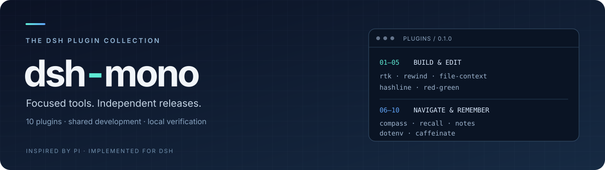

<p align="center">
  
</p>

<p align="center">
  
  
  <a href="LICENSE"></a>
</p>

# dsh-mono

面向 **dsh 的十个独立插件**：从 pi 扩展的使用场景出发，重新实现命令优化、文件编辑、上下文管理和开发工作流。主仓库负责统一开发与验证，每个插件拥有独立 GitHub 仓库和发布包，可按需安装。

**当前版本 `0.1.0`。** 本地检查已通过：10/10 插件，Node 24 和 26 均通过全部 43 项测试；十包分别在十个独立临时目录完成安装、真实 dsh ACTIVE 与工具注册验证，再在一个十包合装 host 中通过 model → tool → model 往返验证，CLI 和 scaffold smoke 也已通过。GitHub Release 尚未发布。首版采用独立行为实现，迁移范围见[迁移说明](docs/migration.md)。

[插件列表](#plugins) · [快速开始](#quick-start) · [本地开发](#development) · [发布方式](#releases) · [pi → dsh 迁移说明](docs/migration.md) · [验收结果](docs/verification.md) · [包清单](docs/packages.json) · [社区目录投稿](docs/community-submissions.md)

## Plugins

只保留具有独立用途的十项。LSP、analytics 和 PR 功能由 dsh 原生提供，不在本集合重复实现。具体命令、配置与首版边界见各插件 README 和[迁移说明](docs/migration.md#首版支持与迁移差异)。

| 插件 / 独立仓库 | 用途 | 上游参考 |
| --- | --- | --- |
| [dsh-rtk-optimizer](https://github.com/LIghtJUNction/dsh-rtk-optimizer) | 压缩模型可见终端输出，提供显式 RTK 命令建议 | [pi 来源](https://github.com/MasuRii/pi-rtk-optimizer) |
| [dsh-rewind](https://github.com/LIghtJUNction/dsh-rewind) | 用 Git 检查点恢复文件，保留可追溯历史 | [pi 来源](https://github.com/arpagon/pi-rewind) |
| [dsh-file-context](https://github.com/LIghtJUNction/dsh-file-context) | 保存文件与 diff 的上下文快照 | [pi 来源](https://github.com/narumiruna/pi-extensions/tree/main/packages/pi-file-context) |
| [dsh-hashline](https://github.com/LIghtJUNction/dsh-hashline) | 通过行哈希锚点编辑，识别过期内容 | [pi 来源](https://github.com/coctostan/pi-hashline-readmap) |
| [dsh-red-green](https://github.com/LIghtJUNction/dsh-red-green) | 以测试证据推进 RED → GREEN → REFACTOR | [pi 来源](https://github.com/MattDevy/pi-extensions/tree/main/packages/pi-red-green) |
| [dsh-compass](https://github.com/LIghtJUNction/dsh-compass) | 生成代码地图，辅助仓库导航 | [pi 来源](https://github.com/MattDevy/pi-extensions/tree/main/packages/pi-compass) |
| [dsh-recall](https://github.com/LIghtJUNction/dsh-recall) | 保存与检索显式选择的项目对话摘录 | [pi 来源](https://github.com/narumiruna/pi-extensions/tree/main/packages/pi-recall) |
| [dsh-notes](https://github.com/LIghtJUNction/dsh-notes) | 维护带修订检查的 Markdown 笔记 | [pi 来源](https://github.com/narumiruna/pi-extensions/tree/main/packages/pi-notes) |
| [dsh-dotenv](https://github.com/LIghtJUNction/dsh-dotenv) | 显式加载 dotenv，保留继承的环境变量 | [pi 来源](https://github.com/narumiruna/pi-extensions/tree/main/packages/pi-dotenv) |
| [dsh-caffeinate](https://github.com/LIghtJUNction/dsh-caffeinate) | 在 agent 运行期间保持电脑唤醒 | [pi 来源](https://github.com/narumiruna/pi-extensions/tree/main/packages/pi-caffeinate) |

清单以 [`plugins.json`](plugins.json) 为准。来源、选择依据与兼容性核对见[迁移说明](docs/migration.md)，stars、上游 commit 和排除依据记录在[上游审计](docs/upstream-audit.json)。

## Quick start

需要 Node.js **24+** 和 **dsh `0.2.1-rc.2`**。先从源码生成本地安装包，再加入 `web` profile：

```bash
git clone --recurse-submodules https://github.com/LIghtJUNction/dsh-mono.git
cd dsh-mono
npm ci
npm run check
npm run pack
dsh plugin --profile web add "$PWD/.artifacts/packages/lightjunction-dsh-hashline-0.1.0.tgz" --ignore-scripts
```

`npm run pack` 将插件包写入 `.artifacts/packages/`。替换文件名即可安装其他插件；重启目标 profile 后使用，命令和配置见对应插件 README。包内已包含构建结果，`--ignore-scripts` 禁用安装生命周期脚本。

## Development

主仓库使用 npm workspaces 统一开发，以 Git submodule 管理各独立插件。

已有 checkout 可补齐子模块：

```bash
git submodule update --init --recursive
```

| 根目录命令 | 用途 |
| --- | --- |
| `npm run check` | 执行统一的并行本地检查入口 `scripts/check.mjs` |
| `npm test` | 运行各 workspace 的测试 |
| `npm run build` | 构建各 workspace |
| `npm run pack` | 十个独立临时目录逐包安装并验证真实 dsh ACTIVE 与工具注册，再在一个十包合装 host 中验证 model → tool → model 往返 |
| `npm run test:cli` | 使用独立 `DSH_HOME` 安装十个包，检查 dump-config 与 headless CLI 启动 |

单独开发某个插件，也可克隆它的独立仓库，在仓库内运行 `npm ci`、`npm run check` 和 `npm pack`。主仓库与独立 checkout 的依赖安装各自进行。

### Scaffold a plugin

在根目录创建新插件骨架：

```bash
node scripts/new-plugin.mjs dsh-name 'description' 'upstreamURL'
```

将示例值替换为真实名称、描述与来源 URL，然后完成实现、测试、来源说明和发布配置，并同步维护根清单与本文索引。

## Releases

**每个插件独立发布。** 插件仓库的发布工作流由 `v*` tag 触发，执行 `npm ci`、`npm run check` 和 `npm pack`，再将 `.tgz` 与 `SHA256SUMS` 上传到 GitHub Release。首批插件统一使用版本 `0.1.0`。

**主仓库只汇总产物。** 根目录 `.github/workflows/release.yml` 仅通过 tag 或手动触发，用于汇总 artifacts，不作为日常 push / PR 自动检查入口。

普通提交与推送不创建 Release；初次源码交付不要求打 tag。需要发布时再另行打 `v*` tag。两条发布路径均不自动执行 `npm publish`，也不依赖 npm token。

### 从 GitHub Release 安装（发布后）

发布后可直接安装独立仓库的资产：

```bash
dsh plugin --profile web add https://github.com/LIghtJUNction/dsh-hashline/releases/download/v0.1.0/lightjunction-dsh-hashline-0.1.0.tgz --ignore-scripts
```

scoped 包 `@lightjunction/dsh-hashline` 的 `npm pack` 文件名为 `lightjunction-dsh-hashline-0.1.0.tgz`。其他插件遵循相同命名规则。需核验下载包时，将 `.tgz` 和 Release 中的 `SHA256SUMS` 下载到同一目录，运行 `sha256sum -c SHA256SUMS`。

## Contributing

修改插件时，在对应子模块中完成实现和本地验证，再由主仓库更新子模块引用。提交前运行与修改相关的检查；修改安装、配置或行为时同步更新插件 README 和[迁移说明](docs/migration.md)。

## License & attribution

根仓库采用 [MIT](LICENSE)。pi 上游是行为与设计参考；各插件的来源、许可证和归属说明以其 `UPSTREAM.md`、`NOTICE` 与 `LICENSE` 为准。
